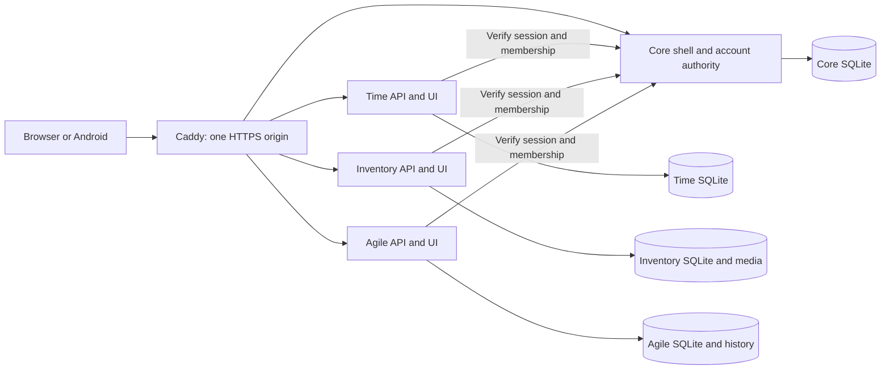

# Digital Core Office architecture and roadmap

## Implemented architecture

Digital Core Office has three independently selectable products: Time Tracking,
Inventory Management, and Agile Project Management. Core and the selected products
run behind one HTTPS origin. Core owns the shell, accounts, password resets,
sessions, memberships, and licenses. Each product remains useful when the other
two are disabled.

Products verify Core on every suite request through `packages/core-client`.
Local profiles retain domain data and historical references; they link or are
created on first authorized access. Account management belongs to Core. APIs
enforce session revocation, inactive accounts, removed memberships, and write
restrictions. Historical module credentials cannot bypass Core.

The shell retains navigation while the same-origin product workspace changes.
Language/theme preferences, enabled-product navigation, and `packages/suite-ui`
provide the shared experience. Product roles remain specific to their workflows;
suite administration and product administration have distinct responsibilities.

The single client in `android-app` opens all enabled products, including Projects,
using the company's selected HTTPS server and Core login. It includes native QR
scanning, server switching/recovery, and file exports. Older module-specific mobile
build support is a compatibility path; the company release uses the suite client.
See [Android documentation](../android-app/README.md).

## Product boundaries

| Product | Current responsibility |
| --- | --- |
| Time Tracking | Time/break entries, absences, approvals, employment terms/balances, calendars, holidays, CSV/calendar exports, time notifications and audit history |
| Inventory Management | Catalog, locations, procurement/receiving, stock, low-stock views, custody assignments/returns, receipt corrections/reversals, journal/export, attachments and QR workflows |
| Agile Project Management | Shared work items, sprint boards, stakeholders/decisions, server persistence, permissions, concurrent-edit protection, import/export and change history |

The directory name `agile-project-management-prototype` remains for compatibility;
Agile now has a server-backed workspace. New workspaces start empty. Version checks
and request IDs protect concurrent updates. Browser-local prototype work is
recovered only by explicit administrator import after exporting an original copy.

Products must not import another product's internal source or read its database.
Shared identity, presentation, and navigation belong in shared packages/platform
APIs. Cross-product business integration should use explicit authorized APIs with
clear ownership of records and references.

## Deployment and migration

`deploy/` is the supported company deployment. `DCO_ENABLED_MODULES` and matching
`COMPOSE_PROFILES` select any valid product combination. Disabled products are not
exposed. The separate `backup` profile snapshots Core, enabled products, and media
into authenticated encrypted bundles. Restore verifies into a new isolated
directory before stopped services switch to new volumes. Each module snapshot is
consistent; snapshots are not a simultaneous cross-product transaction.

Export Time's encrypted userbase through its application, then import the protected
JSON into Core. Inventory/Agile imports use consistent source snapshots. Importers
grant only their source product memberships. Finish every source import before
users first sign in, then manage credentials and access in Core. Routine password
synchronization between products is no longer an operational step. Retain the
previous deployment and original keys through cutover and rollback checks.

See the [deployment guide](../deploy/README.md) and
[migration procedure](../deploy/migration/README.md) for operational commands.

## Future roadmap

These remain future work rather than delivered feature claims:

- Shared teams/groups and organization structure, with explicit mappings to each
  product's permissions and ownership.
- A shared notification inbox and delivery preferences, extending existing
  product-specific mail flows.
- Common audit terminology and authorized cross-product audit search while
  retaining each product's original domain history.
- Documented integration APIs, stable reference IDs, event delivery, and recovery
  from failed cross-product operations.
- Further Agile roadmap planning, dependencies, releases, risks, and
  software/hardware delivery coordination as distinct validated workflows.
- Shared date/calendar controls and additional visual consistency where useful.

Adjacent candidates are a company document/knowledge library, service and
maintenance management tied to inventory assets, and purchasing/vendor management
extending order/receiving workflows. Each needs a bounded first use case and should
consume Core identity without duplicating account administration.
